# Light-leak removal

**Goal:** to remove light leaks from film scans while preserving the film aspect.

I tested 145 film scans, each with at least one light leak. Each scan was fixed in five ways: the in-house method, Gemini Nano Banana 2.1, Gemini Nano Banana Pro, and the in-house method followed by each of the two models. Three tests were used to compare them: a blind eye test, a leak-left measurement inside the leak boxes, and the colour difference outside the boxes. This README describes each test and the logic behind it.

## Install and run

    pip install -r requirements.txt
    python -m leakfix.app          # local web app at http://127.0.0.1:7860

Or `pip install -e .` then `leakfix`.

In the app, load a scan, drag one box around each light leak and press **Apply**. Check the result with *Show original | current*, then press **Save full-resolution JPEG** to write `<scan>_fixed.jpg` next to the scan. Every applied box is logged in `<scan>.boxes.json`.

The same method from the command line:

    python -m leakfix.cli scan.jpg --recipe v2 --leak x0,x1,y0,y1 -o fixed.jpg
    python -m leakfix.cli scan.jpg --replay scan.boxes.json -o fixed.jpg

To measure how much another version of a scan (for example a Gemini edit) changed it outside the leak boxes:

    leakfix-compare scan.jpg --version gemini=gemini.png --boxes scan.boxes.json

## Conclusion

- **Eye test:** Gemini on the raw scan, without the in-house processing, was ranked first on 75% of the scans (109 of 145).
- **Leak test:** the in-house processing followed by either Gemini model removed the most leak. The median leak left was 8.4% with Nano Banana 2.1 and 10.7% with Nano Banana Pro, against 17.8–20.2% for Gemini alone.
- **ΔE76 test:** the in-house processing alone barely changed the colour outside the leak boxes, with a median ΔE76 of 0.46. The other four versions all changed it by about the same amount, a median ΔE76 of 4.7–5.1.

## What was compared

| Version | How it was made | Eye test | Leak and colour tests |
|---|---|---|---|
| In-house alone | The four preprocessing steps below, run on my leak boxes. | N/A | yes |
| NB Pro alone | Nano Banana Pro (`gemini-3-pro-image`) on the raw scan. | yes | yes |
| NB 2.1 alone | Nano Banana 2.1 (`gemini-nano-banana-2.1`) on the raw scan. | yes | yes |
| In-house + NB Pro | In-house output, then Nano Banana Pro. | yes | yes |
| In-house + NB 2.1 | In-house output, then Nano Banana 2.1. | yes | yes |

> **Gemini Prompt:** Remove the light leak from this, but keep the film aspect

## Preprocessing: the in-house method

The in-house method removes a leak by **measuring the cast and subtracting it**. It does not regenerate any pixels. I draw one box around each leak.

- The method pads each box by 2 tiles and works only inside the padded boxes.
- A tile is 64 × 64 px.
- The four steps run in order, each on the previous result. Two safeguards follow.

**How to read the step figures.** Each figure has three rows: the full frame, then the yellow-boxed area enlarged, then a heat map of the colour change each step made.

- The **dashed white box** is the leak box I drew. The **yellow box** is the area enlarged in rows 2 and 3.
- Each **heat map** shows the colour change (ΔE76) that step made compared with the panel before it. The last map compares the final image with the original.
- **Median** is the change at the typical pixel in the enlarged area. **Max** is the most-changed pixel.
- Each map has its own colour scale, so small steps stay visible next to large ones.

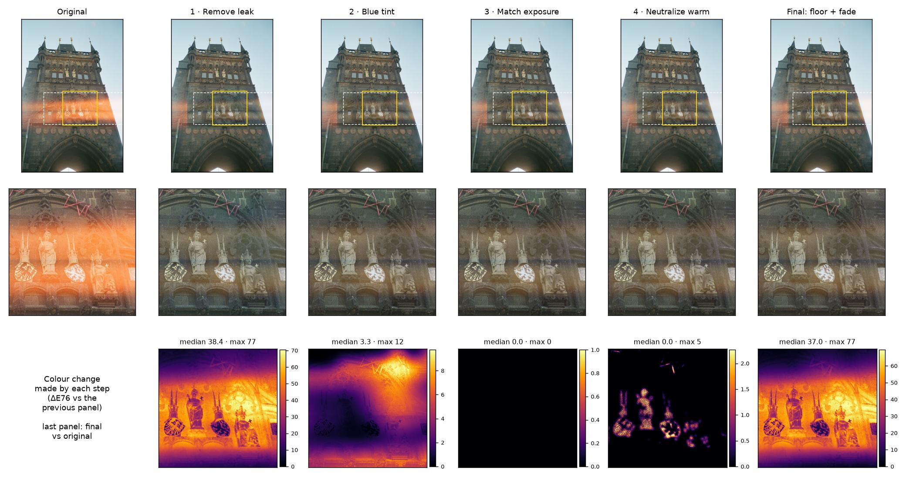

`prague_powder_tower`, an orange band across the statues.

- Step 1 removes most of the band (median 38).
- Step 2 corrects a small cyan overshoot, mostly at the top right (max 12).
- Step 3 is skipped: neither side strip matched the box edge, so its map is black.
- Step 4 touches only the brightest stone, the statues and shields (max 5).
- The final map has the shape of the leak and fades out at the box edges.

### Step 1: Remove the leak (runs twice)

**What it does**

1. Split the box into 64 × 64 px tiles.
2. In each tile, look at the darkest pixels and measure how orange they are.
3. Measure the same thing in the tiles just outside the box. That is what the area should look like without the leak.
4. The extra orange inside the box is the leak. Smooth it out and subtract it from the photo.
5. Run the whole step a second time on the result, to remove what is left.

**Why**

- **Why the darkest pixels:** a light leak works like an orange fog laid over the photo. Dark pixels have little colour of their own, so any orange in them comes mostly from the fog. That makes them a good gauge of how strong the leak is.
- **Why compare with the tiles outside the box:** if the whole scene is warm, like a sunset or a red wall, the tiles outside the box are warm too. That warmth is not mistaken for leak, and only the extra orange inside the box is removed.
- **Why it is gentler in shadows and highlights:** film squeezes colour in its darkest and brightest areas, so the method removes less there to avoid crushing shadows or tinting highlights. It also eases off over the last 8 px at the box edge, so there is no hard line.
- **Why twice:** one pass left some orange behind on my test scans. The second pass measures what is left and removes it.

### Step 2: Remove blue tint

**What it does.** The same tile estimator with the channels swapped: B−R and G−R, anchored on red. It finds a cyan cast and subtracts it.

- A tile counts as cyan when its mean B−R is more than 0.02 above the median of up to 3 tiles on the same row just outside the box.
- If at least 10% of the box's tiles are cyan, the correction runs at gain 1.0, but only on the cyan tiles, through a soft mask.

**Why.**

- **Overshoot.** Where the leak was strongest, step 1 can overshoot past neutral into cyan.
- **The gate.** Fixing only tiles that are bluer than their own row keeps a genuinely blue sky or wall from being warmed. A sky beside the box is just as blue, so it is not flagged.

### Step 3: Match exposure

**What it does**

1. Look at a strip of the photo just left or right of the box, 2 tiles wide.
2. Check that the strip is the same surface continuing past the box: row by row, its brightness has to rise and fall the way the box edge does.
3. If it matches, brighten each row of the box to the brightness of the same row in the strip.
4. If neither side matches, skip this step for that box.

**Why**

- **Why brighten:** removing the orange fog also removes the light it added, so the fixed area can end up duller or darker than the area around it.
- **Why check the strip first:** so a dark doorway is not brightened to match a bright wall next to it. The step only runs when the reference is clearly the same surface, and never uses a strip that sits mostly inside another leak box.
- **Safety limits:** it only ever brightens, never darkens, and by at most 1 stop (double the brightness). The change is smoothed from row to row so there are no stripes.

### Step 4: Neutralize warm

**What it does**

1. Look inside each leak box, plus one extra tile around it.
2. Find the pixels that are both bright and strongly orange-yellow.
3. Tone those pixels down toward neutral by moving their red part of the way toward their green.
4. Soften the edges of this selection so there is no visible outline.

**Why**

- **Why it is needed:** at the hottest centre of a leak, the film is overexposed. There the orange is not simply laid on top, so subtracting it in step 1 leaves a bright orange-yellow glow behind.
- **Why only bright orange pixels:** that is exactly where the leftover glow sits. Darker areas and other colours are left untouched.
- **Limit:** something that really is bright orange or red inside the box, like a sign, can be toned down too.

### Safeguards: black-point floor and leak-mask fade

**Black-point floor.** Removing the leak can push dark areas too far, into a flat black the film never had. To prevent this:

1. The method first finds how dark the blacks are in the rest of the photo, outside the leak boxes.
2. No pixel in the box may end up darker than that. A pixel that was already darker to begin with may not get any darker.
3. Where a step would cross this limit, its change is pulled back.

**Leak-mask fade.** The final image is blended as `original + mask × (corrected − original)`.

- The mask comes from the original's per-tile warm excess: excess divided by 30% of the peak, zeroed below 0.15, smoothed, and tapered to 0 at the edge of the padded boxes.
- The correction is strongest where the leak is strongest and fades smoothly to nothing, so there is no visible box seam.
- Outside the padded boxes the output is bit-identical to the scan.

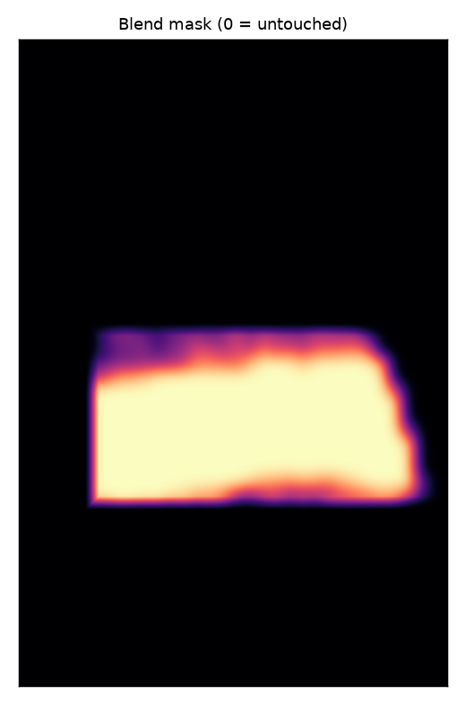

The blend mask for `prague_powder_tower`. Black pixels keep the original exactly.

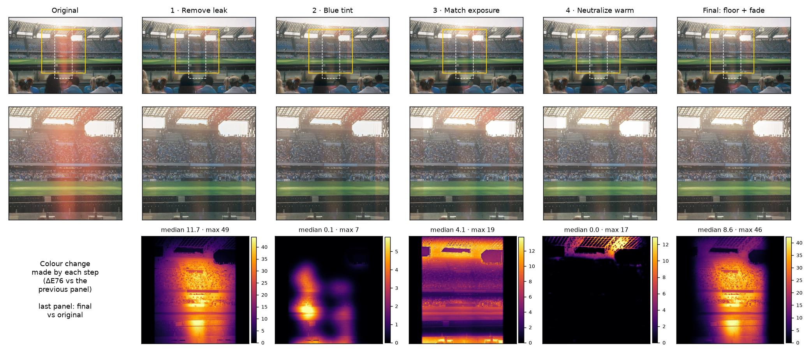

`naples_stadium_crowd_01`, a vertical streak through the stand.

- Step 1 removes the streak (median 11.7, max 49).
- Step 2 makes only small cyan corrections (max 7).
- Step 3 does run here: it lifts the box to match the stand on the left, visible as a band across the box.
- Step 4 only touches the bright roof.
- The final map (median 8.6) has the shape of the streak and fades out at the box edges, so the rest of the stand is untouched.

## Results: colour difference and leak left

| Version | Median ΔE76 outside the boxes | Median leak left inside the boxes |
|---|---:|---:|
| In-house alone | **0.46** | 25.9% |
| NB Pro alone | 4.81 | 20.2% |
| In-house + NB Pro | 4.74 | 10.7% |
| NB 2.1 alone | 5.01 | 17.8% |
| In-house + NB 2.1 | 5.07 | **8.4%** |

ΔE76: the colour change compared with the original. About 2.3 is just noticeable, and 5 or more is clearly visible. Leak left: the percentage of the original leak that remains (original = 100%). Lower is better in both columns. The best value in each column is in bold.

## Test 1: colour difference outside the boxes

**What it measures:** how much each version changed the parts of the photo that had no leak.

**How**

1. Line each version up with the original scan, so every pixel is compared with the same spot.
2. Leave out the leak boxes, a margin around them, and the very edge of the frame.
3. For every remaining pixel, measure how different its colour is from the original (ΔE76).
4. Take the median for each scan, then the median across all scans.

**Why:** a leak fix should change the leak and nothing else, so any change outside the boxes is damage. As a rough guide, a ΔE76 of about 2.3 is just noticeable, and 5 or more is clearly visible.

**What the numbers show**

- The in-house method barely touches the rest of the photo.
- Every Gemini version redraws the whole frame, so the rest of the photo shifts too, usually slightly bluer.
- This test separates the in-house method from Gemini, but not the Gemini versions from each other.

## Test 2: leak left inside the boxes

**What it measures:** how much of the orange leak is still there after each fix.

**How**

1. Line each version up with the original, as in Test 1.
2. Inside each leak box, run the same leak measurement as Step 1 of the in-house method, but without removing anything. It measures how much extra orange there is compared with the area just outside the box.
3. Compare with the original scan: 100% means the leak is untouched, and 0% means no extra orange is left.

**Why:** it measures exactly what a leak is, extra orange compared with the clean area next to it, in the same way for every version.

**Limits**

- It uses the in-house method's own measurement, so on some scenes it can be too harsh or too easy on that method.
- A version that hides the leak by darkening or repainting the area scores well here, even if it looks wrong. That is why the eye test decides.

## Test 3: blind eye test

This is the deciding measure.

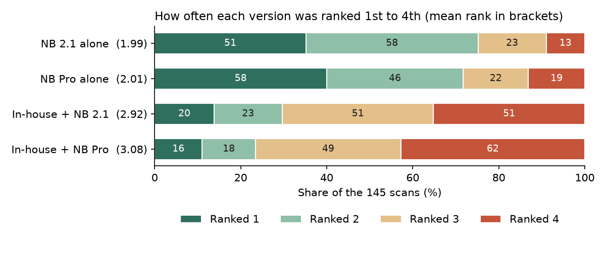

How often each Gemini version was ranked 1st (dark green) to 4th (red), with the mean rank in brackets.

| Version | Mean rank | Ranked 1st | 2nd | 3rd | Ranked last |
|---|---:|---:|---:|---:|---:|
| NB 2.1 alone | **1.99** | 51 | 58 | 23 | 13 |
| NB Pro alone | 2.01 | 58 | 46 | 22 | 19 |
| In-house + NB 2.1 | 2.92 | 20 | 23 | 51 | 51 |
| In-house + NB Pro | 3.08 | 16 | 18 | 49 | 62 |

**What it measures:** which version looks closest to the original photo, in colour and overall look, as it would look without the leak. It does not measure how much leak was removed.

**How**

1. For each scan, shuffle the four Gemini versions and label them A to D, so the judge cannot tell which is which.
2. Show them next to the original, both as the full photo and as a close-up of the leak area.
3. Rank them from best (1) to worst (4).

**What counts most**

1. The leak area matches the colour of the rest of the photo.
2. No leftover orange glow.
3. Overall colour, brightness and grain match the original.
4. Nothing new is invented.

## Example strips

Each strip shows the original with its leak boxes (dashed) and the five versions aligned to it. Below each version is a 1:1 crop of the yellow region, labelled with that scan's leak left and ΔE76 outside.

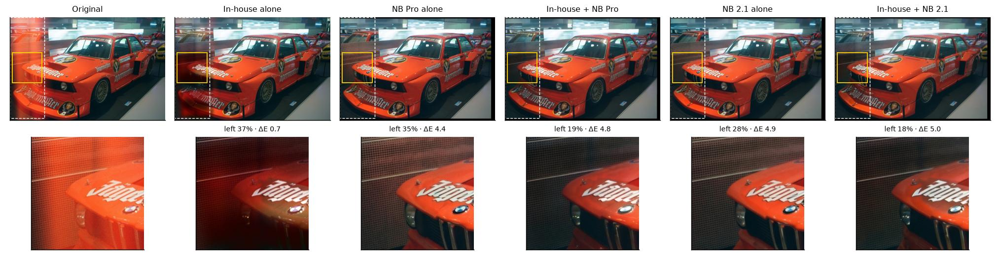
`bmw_museum_jagermeister_racecar`

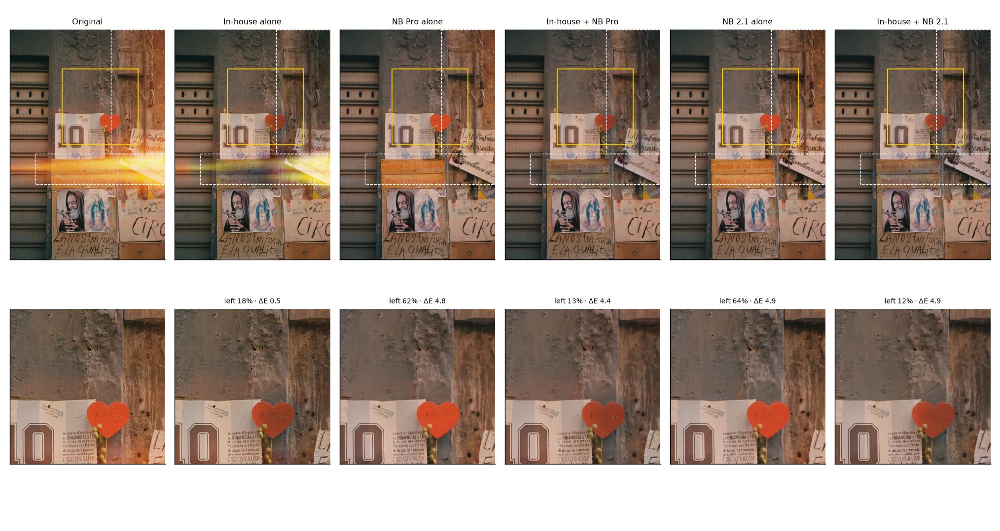
`naples_maradona_shrine_wall`

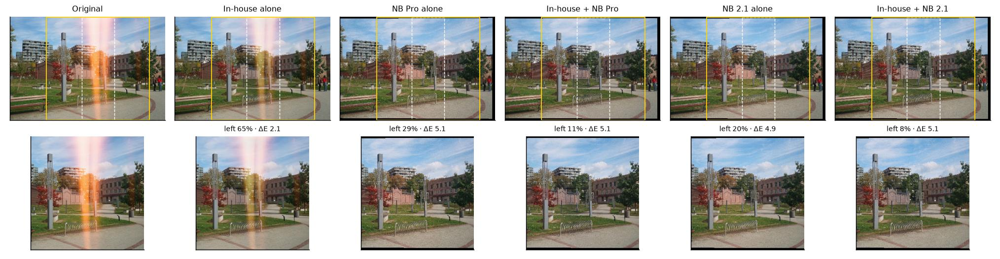
`katowice`

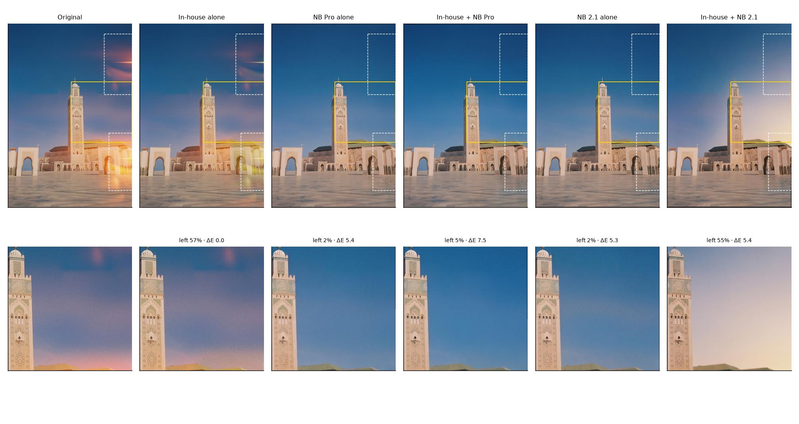
`casablanca_hassan2_minaret_2`

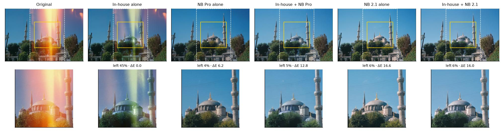
`istanbul_blue_mosque_minarets`

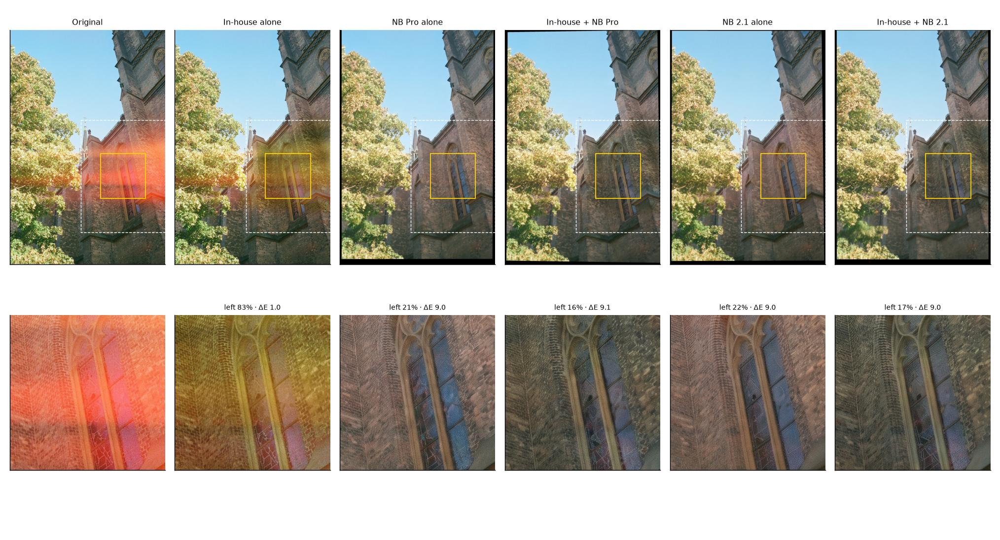
`prague_church_wall_tree`

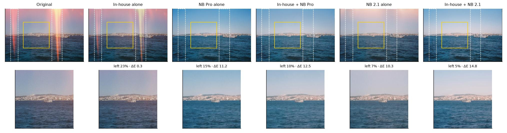
`bosphorus_horizon_2`

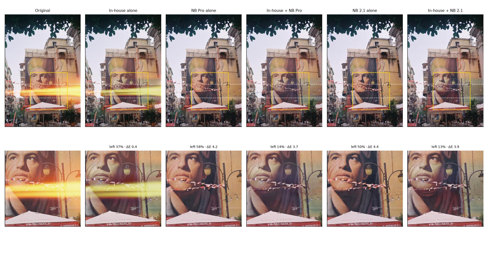
`naples_mural_cafe`

## Author's note

The point of this project is not only to restore the image by removing the leak, but to keep the rawness and aesthetic of film. Future work will focus on bringing the ΔE76 outside the leak boxes below 2.5, so the rest of the photo stays visually unchanged.
